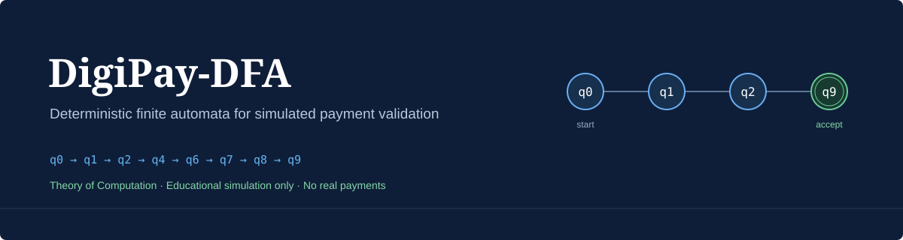
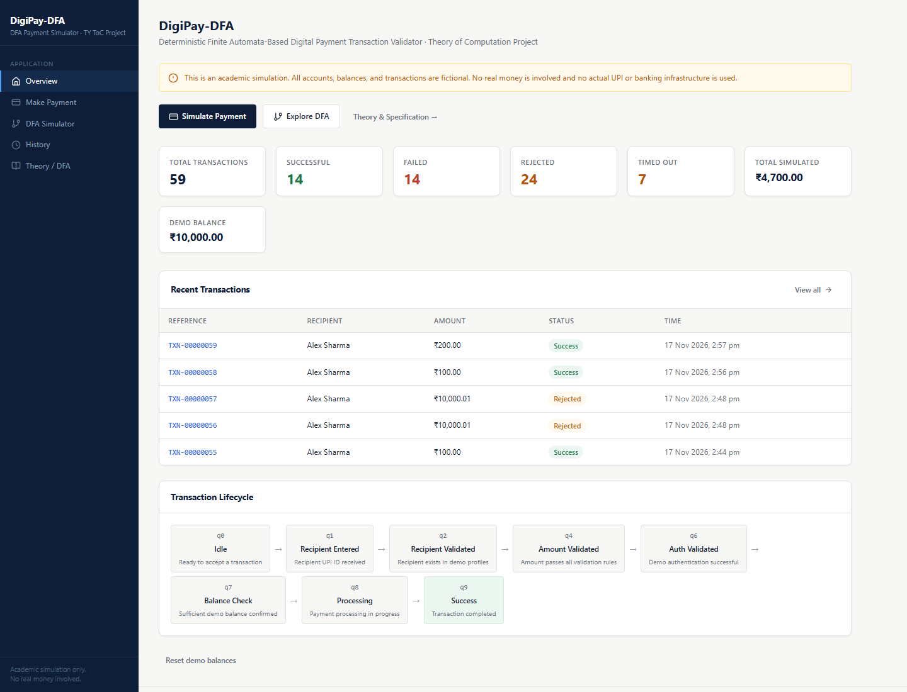
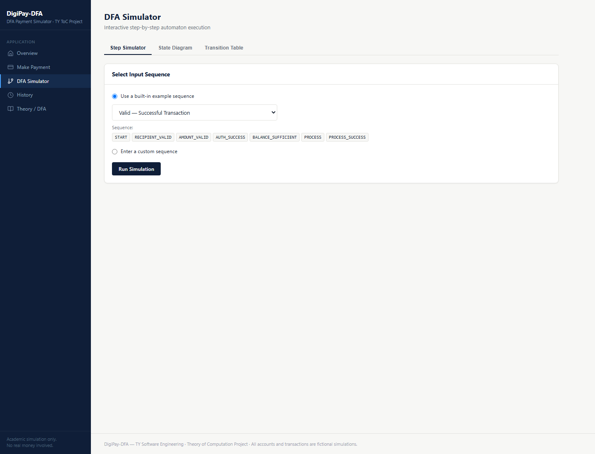
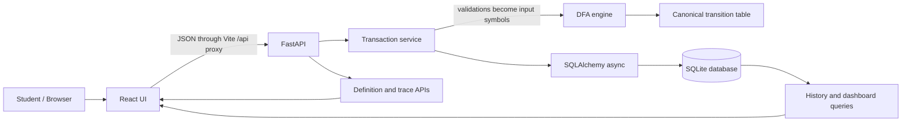

# DigiPay-DFA



**GitHub description:** A DFA-based digital payment transaction validator demonstrating the practical application of Deterministic Finite Automata through a simulated UPI payment system.

> **Academic disclaimer:** This project is an educational simulation. It does not process actual UPI payments or connect to banking infrastructure. All accounts, balances, and transactions are fictional.

## Screenshots

| Overview dashboard | DFA simulator |
|---|---|
|  |  |

## Features

- Models the transaction lifecycle with a deterministic finite automaton, $M=(Q,\Sigma,\delta,q_0,F)$.
- Defines 14 states, 14 input symbols, and all 196 state/symbol transitions.
- Includes seven simulated payment outcomes: success, invalid recipient, invalid amount, authentication failure, insufficient balance, processing failure, and timeout.
- Shows an interactive step-by-step DFA trace and a state diagram driven by the backend definition.
- Provides a searchable, filterable, paginated transaction history with persisted details and traces.
- Calculates dashboard totals from SQLite records.
- Stores money as integer paise and writes successful transfers to an account ledger.
- Supports idempotency keys and avoids duplicate deductions for repeated requests.
- Exposes a FastAPI API with interactive Swagger documentation.

## Technology Stack

| Area | Technology |
|---|---|
| Frontend | React 18, React Router 6, Vite 5, CSS |
| Backend | Python, FastAPI, Pydantic, SQLAlchemy async |
| Database | SQLite with aiosqlite |
| Tests | pytest, Vitest, React Testing Library, HTTPX |
| CI | GitHub Actions, Python 3.11, Node.js 20 |

## System Architecture



The frontend submits requests to FastAPI. The transaction service checks the demo recipient, amount, and sender balance, constructs the corresponding event sequence, then asks the DFA engine for the terminal state and trace. The service persists the transaction and trace; it records debit/credit ledger entries only when the DFA reaches SUCCESS. Dashboard and history views read from those persisted records.

## DFA Mathematical Model

The machine is $M=(Q,\Sigma,\delta,q_0,F)$:

- $Q=\{q_0,q_1,\ldots,q_{13}\}$: 14 finite states.
- $\Sigma$: `START`, `RECIPIENT_VALID`, `RECIPIENT_INVALID`, `AMOUNT_VALID`, `AMOUNT_INVALID`, `AUTH_SUCCESS`, `AUTH_FAILURE`, `BALANCE_SUFFICIENT`, `BALANCE_INSUFFICIENT`, `PROCESS`, `PROCESS_SUCCESS`, `PROCESS_FAILURE`, `PROCESS_TIMEOUT`, and `RESET`.
- $\delta:Q\times\Sigma\to Q$: a total, deterministic transition function with 196 defined entries.
- $q_0$: the initial `IDLE` state.
- $F=\{q_9\}$: the only accepting state, `SUCCESS`.

The states represent stages and outcomes: q0 idle; q1 recipient entered; q2 recipient validated; q3 amount entered (available in the model but skipped in the normal sequence); q4 amount validated; q5 authentication pending (available in the model but skipped in the normal sequence); q6 authentication validated; q7 balance check; q8 processing; q9 success; q10 rejected; q11 failed; q12 timed out; q13 sink.

### Example State Transitions

| Outcome | Input sequence | State path | Status |
|---|---|---|---|
| Successful payment | `START`, `RECIPIENT_VALID`, `AMOUNT_VALID`, `AUTH_SUCCESS`, `BALANCE_SUFFICIENT`, `PROCESS`, `PROCESS_SUCCESS` | q0 → q1 → q2 → q4 → q6 → q7 → q8 → q9 | SUCCESS |
| Invalid recipient | `START`, `RECIPIENT_INVALID` | q0 → q1 → q10 | REJECTED |
| Invalid amount | `START`, `RECIPIENT_VALID`, `AMOUNT_INVALID` | q0 → q1 → q2 → q10 | REJECTED |
| Authentication failure | `START`, `RECIPIENT_VALID`, `AMOUNT_VALID`, `AUTH_FAILURE` | q0 → q1 → q2 → q4 → q11 | FAILED |
| Insufficient balance | `START`, `RECIPIENT_VALID`, `AMOUNT_VALID`, `AUTH_SUCCESS`, `BALANCE_INSUFFICIENT` | q0 → q1 → q2 → q4 → q6 → q10 | REJECTED |
| Processing failure | Valid prefix, then `PROCESS_FAILURE` | … → q8 → q11 | FAILED |
| Processing timeout | Valid prefix, then `PROCESS_TIMEOUT` | … → q8 → q12 | TIMED_OUT |
| Malformed sequence | `AMOUNT_VALID` at q0 | q0 → q13 | SINK |

The engine stops when it enters a terminal state. The sink state catches malformed or out-of-order input. `RESET` returns states to q0. API-level amount constraints reject zero, negative, and above-maximum values with HTTP 422; the `invalid_amount` selector is a demo scenario that exercises the DFA rejection transition with an otherwise valid request.

## Project Structure

```text
digipay-dfa/
├── .github/workflows/ci.yml  # Backend and frontend CI
├── backend/
│   ├── app/
│   │   ├── api/              # FastAPI route handlers
│   │   ├── core/             # Settings and SQLite setup/seeding
│   │   ├── dfa/              # States, alphabet, transitions, engine
│   │   ├── models/           # SQLAlchemy tables
│   │   ├── schemas/          # Pydantic request/response models
│   │   └── services/         # Transaction processing and ledger writes
│   ├── tests/                # Backend unit and API tests
│   ├── .env.example          # Fictional local defaults; no secrets
│   ├── e2e_verify.py         # Live API verification
│   ├── init_demo_db.py       # Create schema and seed demo accounts
│   └── requirements.txt
├── docs/
│   ├── assets/               # Project banner
│   ├── screenshots/          # Captured application screenshots
│   ├── API_DOCUMENTATION.md
│   ├── DFA_SPECIFICATION.md
│   ├── PROJECT_REPORT.md
│   └── VIVA_GUIDE.md
├── frontend/
│   ├── src/components/       # Layout and DFA diagram
│   ├── src/pages/            # Overview, payment, simulator, history, theory
│   ├── src/services/         # Backend API client
│   ├── src/test/             # Vitest and Testing Library tests
│   ├── package.json
│   └── vite.config.js
├── .gitignore
├── CONTRIBUTING.md
├── LICENSE
└── README.md
```

## Prerequisites

- Python 3.10 or later
- Node.js 18 or later and npm
- Git

## Clone and Install

Replace `<your-username>` with the GitHub account or organization that hosts the repository.

```bash
git clone https://github.com/<your-username>/digipay-dfa.git
cd digipay-dfa
```

### Windows Setup

In PowerShell, create and activate a virtual environment and install backend dependencies:

```powershell
cd backend
py -m venv .venv
.\.venv\Scripts\Activate.ps1
python -m pip install -r requirements.txt
Copy-Item .env.example .env
python init_demo_db.py
```

If PowerShell prevents environment activation, either allow activation for the current terminal with `Set-ExecutionPolicy -Scope Process -ExecutionPolicy Bypass` or call `.venv\Scripts\python.exe` directly for the commands below.

Open a second PowerShell terminal in the project root and install frontend dependencies:

```powershell
cd frontend
npm ci
```

### macOS and Linux Setup

```bash
cd backend
python3 -m venv .venv
source .venv/bin/activate
python -m pip install -r requirements.txt
cp .env.example .env
python init_demo_db.py
```

In a second terminal from the project root:

```bash
cd frontend
npm ci
```

The `.env` copy is optional: settings have local demo defaults. The example contains fictional development configuration only and no API keys, passwords, or credentials. On the first backend startup, the app also creates the database schema and seeds any missing demo accounts automatically.

## Run the Application

Start the backend and frontend in separate terminals. The following commands assume the terminal is at the repository root.

**Terminal 1 — backend:**

```powershell
cd backend
python -m uvicorn app.main:app --reload --host 127.0.0.1 --port 8000
```

**Terminal 2 — frontend:**

```powershell
cd frontend
npm run dev -- --host 127.0.0.1
```

Open the UI at <http://127.0.0.1:5173>. The backend API is at <http://127.0.0.1:8000>; interactive Swagger docs are at <http://127.0.0.1:8000/api/docs>.

### Initialize or Seed the Database

From the `backend` directory, run:

```bash
python init_demo_db.py
```

This creates missing tables and inserts any missing fictional demo accounts. It does not delete transaction history or reset existing balances. `backend/digipay.db` and SQLite sidecar files are ignored by Git and must not be committed.

## API Documentation

The full endpoint reference and example payloads are in [docs/API_DOCUMENTATION.md](docs/API_DOCUMENTATION.md). When the backend is running, use Swagger UI at <http://127.0.0.1:8000/api/docs>.

Key endpoints:

| Method | Endpoint | Purpose |
|---|---|---|
| GET | `/api/health` | Health check |
| GET | `/api/dfa/definition` | States, alphabet, and full transition function |
| GET | `/api/dfa/transitions` | Flat transition list |
| POST | `/api/dfa/simulate` | Simulate a supplied symbol sequence and return its trace |
| POST | `/api/transactions` | Create and persist a simulated payment |
| GET | `/api/transactions` | Searchable, filterable transaction history |
| GET | `/api/transactions/{id}` | Transaction details and full trace |
| GET | `/api/dashboard/summary` | Database-backed summary statistics |
| GET | `/api/demo/accounts` | Fictional demo accounts and balances |
| POST | `/api/demo/reset` | Restore demo balances without deleting history |

## Testing

Run the backend tests from `backend/`:

```bash
python -m pytest tests/ -q
```

Run frontend tests and the production build from `frontend/`:

```bash
npm test
npm run build
```

For live API checks, start the backend, then run `python e2e_verify.py` from `backend/`. The end-to-end script creates transaction records and resets demo balances at the end; it does not delete transaction history. Backend tests use an isolated in-memory database.

GitHub Actions runs backend tests, frontend tests, and the production build on pushes and pull requests.

## Demo Scenarios

From **Make Payment**, choose a fictional recipient, enter a valid positive amount, and select one of the scenario options. The scenario selector is a testing aid, not a UPI feature. Then check **History** or **View DFA Trace** to inspect the persisted outcome.

From **DFA Simulator**, choose a built-in sequence and run it one transition at a time. The **State Diagram** and **Transition Table** views show the canonical DFA definition; the table contains all 196 transitions.

Suggested presentation order: successful payment, invalid recipient, authentication failure, insufficient balance, processing timeout, then transaction history and the simulator diagram. Only successful transactions change balances. For a clean repeat demo, use **Reset demo balances** on the Overview page; this preserves history.

## Limitations and Future Enhancements

- This is a local, single-user academic simulation; it is not suitable for real payment processing.
- It has no real UPI, NPCI, bank, authentication, or gateway integration.
- Failure and authentication outcomes are simulated inputs, not security controls.
- SQLite and the local demo accounts are intended for learning and demonstration, not production-scale concurrency or multi-user isolation.
- Possible future work includes database migrations, isolated user sessions, improved automated browser coverage, and additional DFA learning visualizations.

## Contributors

Student author names were not provided for this workspace. Add the project authors here before publishing. See [CONTRIBUTING.md](CONTRIBUTING.md) for the fork, branch, test, and pull request workflow.

## GitHub Repository Metadata

- **Repository name:** `digipay-dfa`
- **Description:** A DFA-based digital payment transaction validator demonstrating the practical application of Deterministic Finite Automata through a simulated UPI payment system.
- **Suggested topics:** `theory-of-computation`, `deterministic-finite-automata`, `dfa`, `python`, `fastapi`, `react`, `sqlite`, `digital-payments`, `computer-science-project`

Set the description and topics in the repository's GitHub **About** settings after creating the remote repository. This project directory is prepared locally; no GitHub remote has been configured or published from this workspace.

## License

This project is distributed under the MIT License. See [LICENSE](LICENSE).
